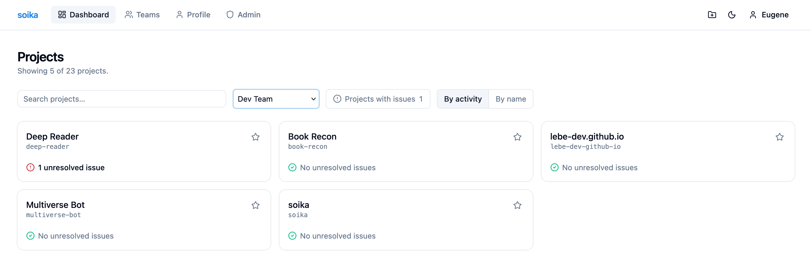

# soika



soika is a lightweight, Sentry-compatible error tracker for collecting and
triaging application errors. The Rust backend and web interface ship together
as a single binary, with SQLite storage.

## Getting started

```sh
docker run -d \
  --name soika \
  -p 8080:8080 \
  -e SECRET_KEY="$(openssl rand -hex 32)" \
  -v soika-data:/app/data \
  tinyops/soika:0.7.0
```

Open [http://localhost:8080](http://localhost:8080) and create the initial
Owner account on the setup page.

## Features

- Accepts events from Sentry-compatible SDKs.
- Groups errors and displays issues, events, stacktraces, tags, and context.
- Supports password login, OAuth/OIDC single sign-on, and passkeys.
- Provides team-based project access and issue triage in the web interface.
- Runs as one binary with embedded frontend assets and an SQLite database.
- Supports English and Russian localizations (`en`, `ru`).
- Blazing fast, built with Rust and SvelteKit.
- Low resource usage — example Docker stats snapshot:

  ```text
  CONTAINER ID   NAME   CPU %   MEM USAGE / LIMIT   MEM %   NET I/O         BLOCK I/O       PIDS
  3cc6acffa7a7   soika  0.00%   17.01MiB / 128MiB   13.29%  725MB / 135MB   49.9MB / 289MB  11
  ```

## Docs

- [Installation and configuration](docs/OPERATIONS.md)
- [User interface](docs/UI.md)
- [Development](DEV.md)
- [MVP scope](MVP.md)
- [Project plan](PLAN.md)

## License

[MIT](LICENSE.md)
