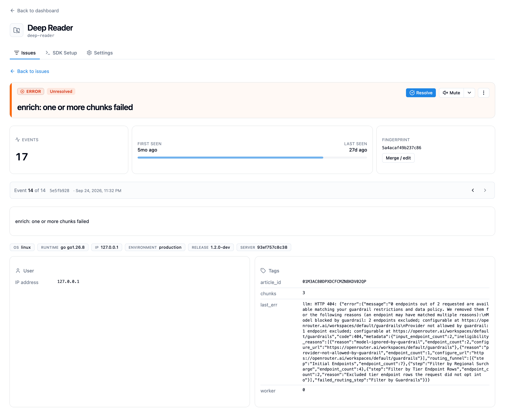
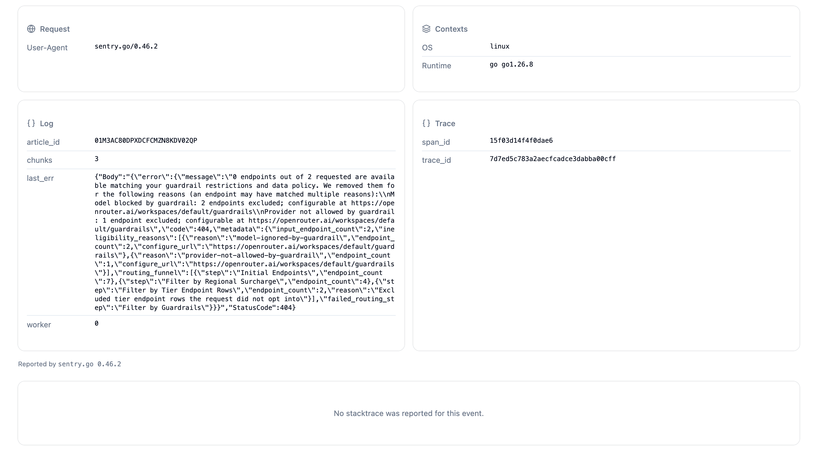
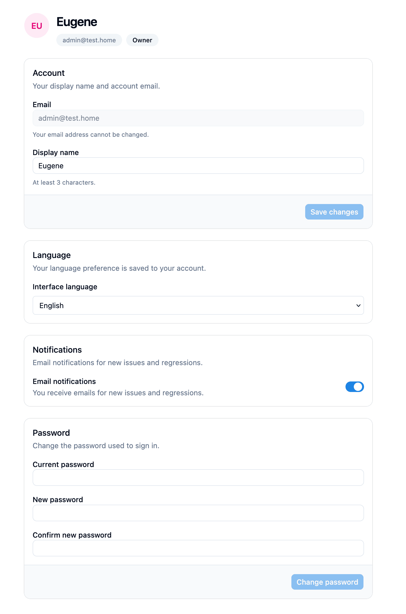
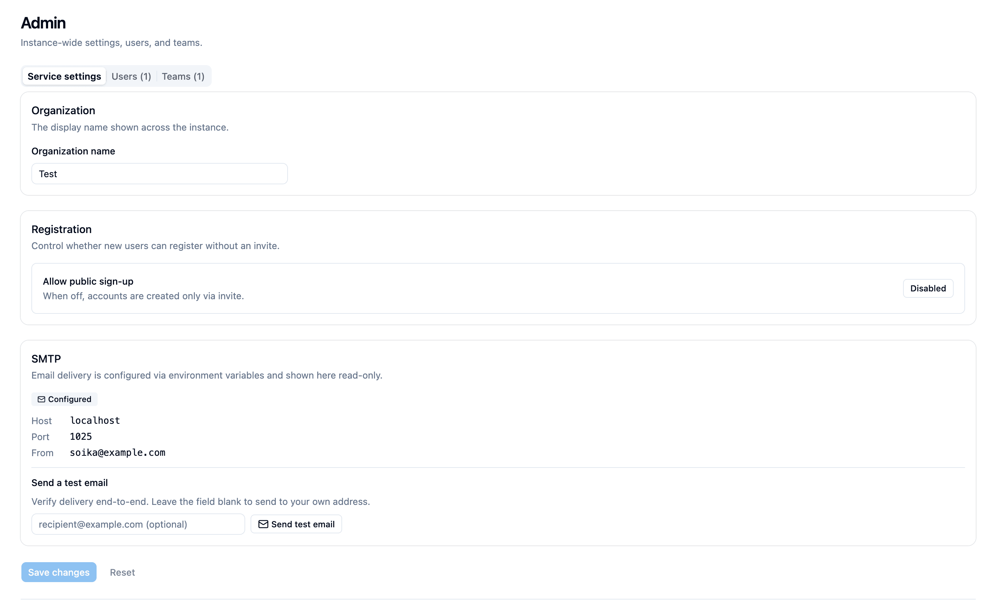

# User interface

## Issue details

The issue page shows issue status and controls, event counts, event context,
tags, request data, and trace information.

The lower part of the page displays request and context fields, structured logs,
trace identifiers, and the stacktrace area when one is available.

## Profile settings

Users can manage their display name, interface language, email notifications,
and password from their profile.

## Instance settings

Instance Owners and Managers can configure organization settings, registration,
and inspect email delivery configuration from the admin page.

